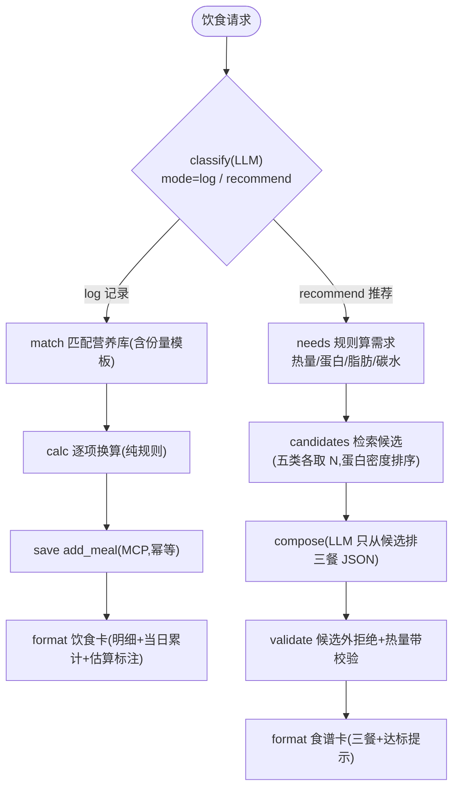

# 个人健康助手 · V2 实施计划(执行版)

> 配套设计:《个人健康助手总体方案与流程图.md》§9(V2 = P5–P7:个性化与可视化)
> 本文件回答:V2 做什么、怎么验收、哪些需要你动手
> 版本 v0.4 · 2026-10-06 · 状态:✅ V2 全部完成(P5–P7,见三份验收记录);V3 实施计划已出(见《个人健康助手V3实施计划.md》,待评审)

---

## 一、执行方式

| 角色 | 事项 |
|---|---|
| **我(AI)** | 在 `D:\work\health-assistant` 内写代码、跑脚本、修 bug、出验收证据;每个 Phase 结束 git 提交;参考目录只读 |
| **你(动手节点)** | ① Docker 保持运行(PG)② P6 需要你点一次「确认写入画像」按钮验收 ③ 每个 Phase 过目验收 ④ P7 看板观感反馈(指标/配色) |
| **节奏** | P5 → P6 → P7 顺序执行,门禁通过才进下一个;随时可裁剪(如 P7 的联动高亮可后置) |

---

## 二、V1 现状与 V2 增量

**V1 已有**:14 表数据底座 / MCP 15 工具 / 记录·分析·计划三图 / 编排+SSE / Vue3 工作台 / 意图评测 60 条。
**V2 新增**(不改 SSE 协议、不改前端骨架):

| Phase | 一句话 | 主要新增 |
|---|---|---|
| P5 | 饮食 Agent:记录估算 + 食谱推荐 | 饮食图(双模式)、份量换算表、需求公式、diet 卡 |
| P6 | 画像与长期记忆 + 计划动态调整 | 编排重构(LangGraph + PostgresSaver)、memory 意图、确认卡、完整调档表、画像页 |
| P7 | 可视化深化 | 热力图 / 四维雷达 / 完成率环形 / 看板联动高亮、评分规则 |

---

## 三、P5 饮食 Agent + 营养库(约 1~1.5 天)

### 3.1 图结构(一张图,双模式)

### 3.2 规则口径(可解释、可单测)

**份量模板**(把"一碗/一个/一杯"折算为克数中值;卡上标注"估算"):一碗米饭≈200g、一个鸡蛋≈55g、一杯牛奶≈250ml、一片面包≈30g、一把坚果≈15g;未命中模板时由 LLM 给克数估计并标注。

**每日需求公式**(规则层,写进 `diet/rules.py`):

| 项 | 公式(演示口径) |
|---|---|
| 维持热量 | 体重(kg) × 30 kcal;训练日 +200 kcal |
| 目标调整 | 减脂 −400 kcal(下限 1300);增肌 +300 kcal;保持健康 0 |
| 蛋白质 | 减脂 1.8 g/kg;增肌 2.0 g/kg;保持 1.4 g/kg |
| 脂肪 | ≥ 0.8 g/kg |
| 碳水 | 剩余热量 ÷ 4 |

**校验**:LLM 排餐只能使用候选库食物;总热量需落在需求 ±15%,蛋白 ≥ 需求 90%;不满足 → 本地拒绝并要求重排(最多 1 次,与 `chat_json` 重试同模式)。

### 3.3 意图与前端

- Router 不变(`diet` 意图已在);饮食图内部判定 log/recommend,移除 V1 的"即将上线"占位
- 卡片:新增 `diet` 卡(记录模式:明细表 + 当日累计;推荐模式:三餐表 + 达标进度)
- 前端 CardBlock 增加 diet 卡渲染

### 3.4 测试与验收

- 离线用例 ≥10:份量模板换算、公式边界(下限/训练日)、候选外拒绝、热量带校验、log 估算落库参数、未命中食物处理
- `scripts/check_diet.py`(真实链路:记录"午饭吃了200g鸡胸肉和一碗米饭"→ 明细与估算正确;推荐"帮我配明天的三餐"→ 全部来自候选库 + 热量带达标;结束复原数据)
- E2E 场景 5 改为真实饮食场景(记录 + 推荐)

**门禁**:✅ 已完成(2026-10-06):`check_diet.py` **10/10**;离线新增 14(合计 **75**);E2E **23/23**(含饮食 2 场景)。过程中修复"候选集把家常食材挤掉"的约束设计问题(改为常用食材优先 + 密度补充 + 重申候选名单),详见《p5_验收记录》。

---

## 四、P6 画像 + 长期记忆 + 计划动态调整(约 1.5~2 天)

### 4.1 编排重构:LangGraph + PostgresSaver(多轮记忆)

- `assistant` 图:三节点 `route`(规则前置 + LLM 意图 + **注入近 6 轮对话**)→ 条件边(rule/clarify → `finalize`;否则 → `dispatch`)→ `finalize`;**SSE 事件协议完全不变**(节点内用 LangGraph custom stream 推事件)
- 编译挂 `AsyncPostgresSaver`(langgraph-checkpoint-postgres,已安装);启动时 `setup()` 幂等建表;`thread_id = 用户`(单用户演示)
- 降级链:PostgresSaver 装配失败 → MemorySaver(重启丢记忆)→ 无记忆仅本轮(日志标注);**记忆不可用不阻塞对话**
- 演示点:"我最近一个月状态怎么样?" → "**那这周呢?**" → 第二条能理解指代(analyze,近 7 天);重启网关后记忆仍在

### 4.2 画像 / 事件抽取 + 确认卡(写入需确认)

- Router 新增意图 `memory`(画像/偏好/事件:"我膝盖不好""下周一到周三出差""目标是增肌")
- `memory` 处理:LLM 抽取 → 校验(白名单字段/日期/长度)→ **不直接写库**,返回 `profile_update` 确认卡 + **签名 token**(jwt_secret 签,10 分钟有效,含待写内容)
- 前端卡上「确认写入 / 忽略」→ `POST /api/v1/memory/apply {token}` → 校验签名与有效期 → 调 MCP `update_profile`(列表字段 append 去重)/ `add_memory_event` → 返回已写入卡
- 纪律:token 防篡改;过期/重复使用返回明确提示;列表字段追加不覆盖

### 4.3 调档规则完整化(对齐方案 §4.2 调档表)

| 信号 | 阈值 | 动作(在 V1 基础上新增) |
|---|---|---|
| 连续体感 | 连续 2 次 feeling_score ≤2 | 插入恢复日 / 降强度(需从周计划读取体感) |
| 同训练 | 同一 title 连续 ≥4 周 | rationale 给换项建议(候选里换一个) |
| 既有 | 完成率/疲劳/事件 | 保留 V1 规则 |

- MCP 新增工具 `list_plans(weeks=4)`(返回近 N 周计划概要+动作标题,供换项判断);工具数 15 → 16
- 计划卡新增 `evidence` 字段:{完成率, 疲惫占比, 连续低体感, 事件列表} → "为什么降强度"在卡片上可查(可解释性)

### 4.4 画像页(前端第四页)

- 页面:目标/身高/目标体重/器械/饮食禁忌/伤病/提醒时间(编辑保存);事件记忆列表(生效中/已过期,手动新增可选)
- REST:`GET/PUT /api/v1/profile`、`GET/POST /api/v1/memory/events`(均包 MCP 工具)

### 4.5 测试与验收

- 离线新增 ≥10:memory 抽取校验、token 签名/过期/篡改拒绝、列表 append 去重、路由注入历史(断言 prompt 含近 6 轮)、连续低体感规则、换项规则
- 验收:①"那这周呢"指代 demo ②确认卡写入闭环(UI 点一次)③重启网关后追问仍懂上下文 ④计划卡 evidence 可见

**门禁**:✅ 已完成(2026-10-06):多轮指代(重启后 days=7);确认卡闭环(篡改 400 / 追加去重 / 有效期过滤);离线 **90 全绿**;E2E **26/26**;工具回归 35/35;评测 77 条(2 条边界项等价口径)。过程修复 4 个问题(Windows psycopg 事件循环、历史缺失、未来事件语义、评测抖动),详见《p6_验收记录》。

---

## 五、P7 可视化深化(约 1 天)

### 5.1 四个图 + 联动

| 图 | 内容 | 数据 |
|---|---|---|
| 日历热力图 | 近 90 天:训练分钟 / 打卡完成数(双击切换) | `GET /api/v1/dashboard/heatmap?days=90` |
| 四维雷达 | 运动达成 / 睡眠充足 / 饮食记录 / 恢复状态,0~100 | `GET /api/v1/dashboard/radar?weeks=4` |
| 完成率环形 | 本周计划完成率(done+0.5×partial) | 复用 `/plans/current` |
| 趋势联动 | 现有 30 天趋势加 dataZoom + 区间高亮 | 复用 `/dashboard/trends` |

### 5.2 评分规则(纯函数 + 单测,写进 stats.py)

- 运动分 = min(100, 训练天数 ÷ 4 × 100)
- 睡眠分 = 100 − |平均睡眠 − 7.5| × 25(平均 <6.5 再 −10),截断 0~100
- 饮食分 = 近 4 周有饮食记录的天数 ÷ 28 × 100(去重日)
- 恢复分 = 100 − 疲惫占比 × 80 − max(0, 连续训练天数 − 2) × 10,截断 0~100
- 说明:评分为规则加权,可解释、可测试;公式注释进代码

- MCP 新增工具 `get_meal_summary`(饮食分出数)+ `get_daily_stats`(热力图按日聚合);工具数 16 → 18(计划原估 17,如实修正)

### 5.3 联动高亮 + 验收

- 对话统计卡加「在看板中查看」按钮 → 会话内记住区间 → 看板加载时 `markArea` 高亮该区间
- 验收:四图可见且数据正确;评分单测过;前端 build/dev 通过;E2E 增加 heatmap/radar 断言

**门禁**:✅ 已完成(2026-10-06):E2E **28/28**(含 heatmap/radar);评分新增 5 用例(合计 **97 全绿**);前端 build 通过;全量回归(MCP 35/35、三图 12/12、记忆 11+2)。过程修复 3 个问题(str 日期兼容、验收脚本 keep-alive 竞态、路由同意图合并),详见《p7_验收记录》。

---

## 六、时间与顺序(按每天 4~6 小时节奏)

| 顺序 | 内容 | 预估 | 卡点依赖 |
|---|---|---|---|
| 1 | P5 饮食 Agent | 1~1.5 天 | — |
| 2 | P6 记忆与个性化 | 1.5~2 天 | 你点一次确认卡 |
| 3 | P7 可视化深化 | 1 天 | 观感反馈 |
| 合计 | V2 | **3.5~4.5 天** | — |

V3(P8–P9:主动服务 + A2A 知识 RAG)与 V4(P10–P11:加固交付)在 V2 验收后滚动编写。

---

## 七、需要你做的事(清单)

1. **Docker 保持运行**(PG;开发期不变)
2. **P6 验收时点一次「确认写入」**(演示画像确认闭环)
3. **P7 给看板观感反馈**(指标口径/配色/布局)
4. 每个 Phase 结束看验收记录(自动生成到 docs/)

---

## 八、门禁总表(V2)

| Phase | 门禁(全过才进下一阶段) |
|---|---|
| P5 | ✅ 已完成(2026-10-06):`check_diet.py` 10/10;离线 75 全绿;E2E 23/23 |
| P6 | ✅ 已完成(2026-10-06):多轮指代(重启后)/确认卡闭环/离线 90/E2E 26/26 |
| P7 | ✅ 已完成(2026-10-06):四图数据正确;评分 5 用例;E2E 28/28 |

---

## 附录 A:接口增量(V2)

| 类型 | 增量 |
|---|---|
| 意图 | 新增 `memory`;`diet` 实做(log/recommend 内部判定) |
| MCP 工具 | 新增 `list_plans`、`get_meal_summary`(15 → 17) |
| REST | `POST /memory/apply`;`GET/PUT /profile`;`GET/POST /memory/events`;`GET /dashboard/heatmap`;`GET /dashboard/radar` |
| 卡片 | 新增 `diet`、`profile_update`;`plan` 卡加 `evidence` 字段 |
| SSE 协议 | **不变**(routing/progress/card/token/meta/done) |

## 附录 B:变更记录

| 版本 | 日期 | 变更 |
|---|---|---|
| v0.1 | 2026-10-06 | 初版:P5–P7 执行清单 + 验收门禁 + 接口增量 |
| v0.2 | 2026-10-06 | P5 完成:饮食 Agent 双模式 + 候选策略修复;证据见《p5_验收记录》 |
| v0.3 | 2026-10-06 | P6 完成:主图 + PostgresSaver 多轮记忆 + 确认卡 + 调档完整化 + 画像页;证据见《p6_验收记录》 |
| v0.4 | 2026-10-06 | P7 完成(V2 收官):热力图/雷达/环形/联动 + 评分规则 + 工具 16→18;证据见《p7_验收记录》 |
