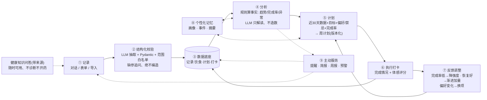
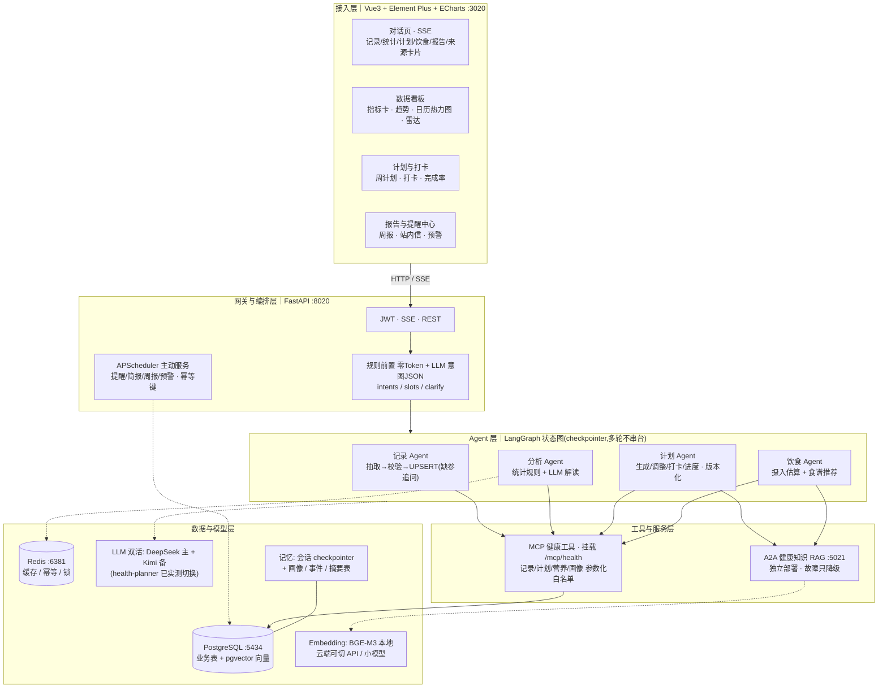
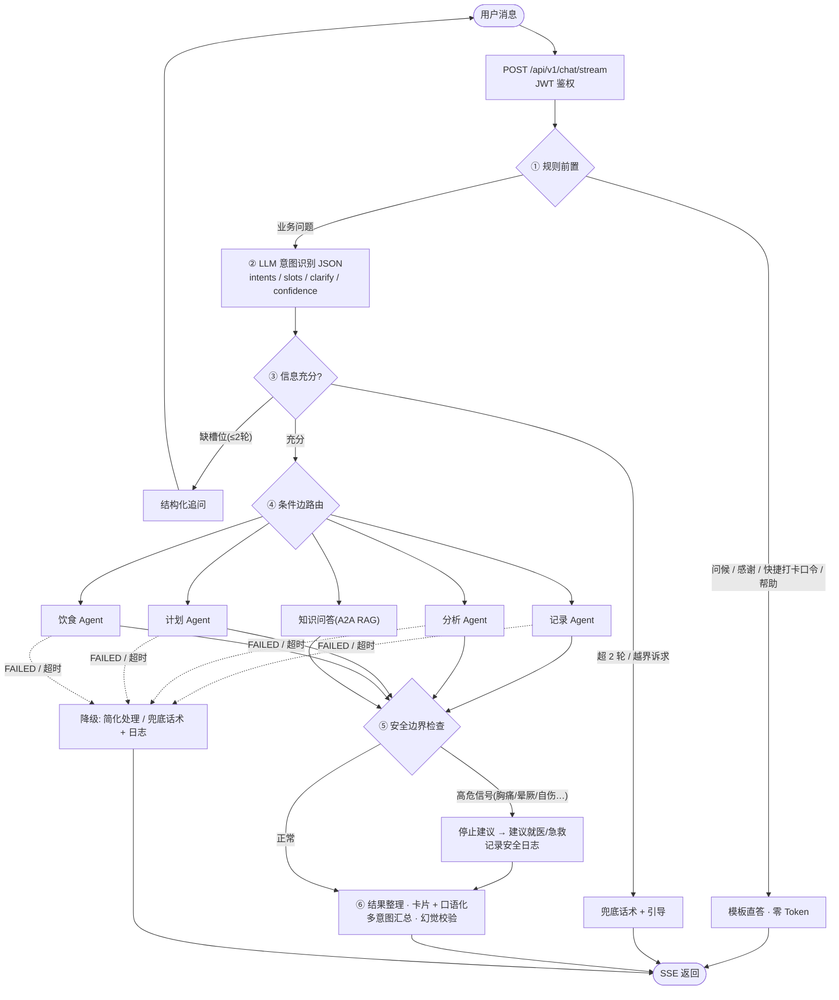
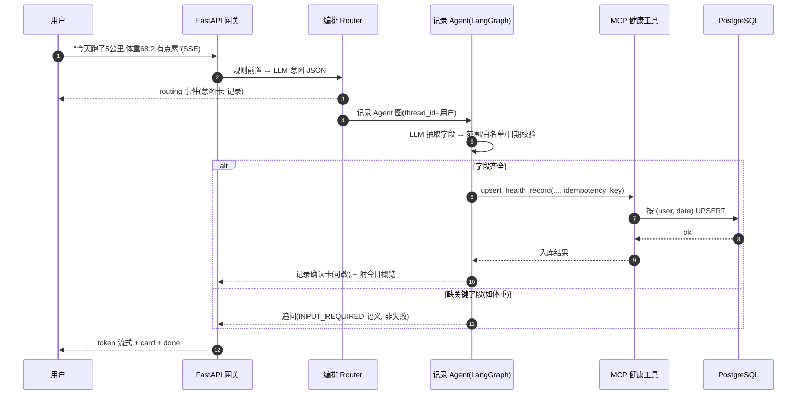
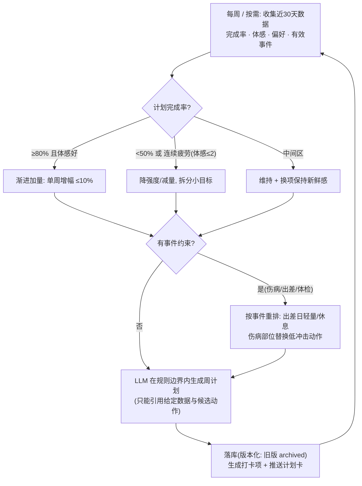
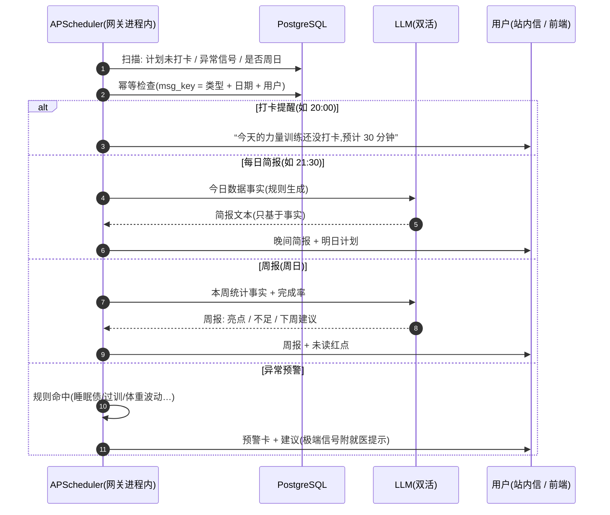
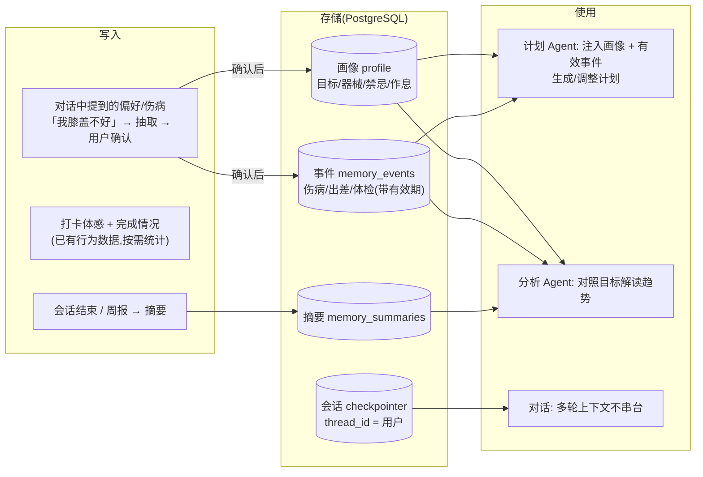

# 个人健康助手 · 总体方案与流程图

> **对应简历**:项目三《基于 LangGraph 的个人健康管理助手》
> **定位**:从「一问一答」升级为「记录 → 分析 → 计划 → 打卡执行 → 反馈调整」的长期闭环,配数据看板与主动服务
> **借鉴来源**(原目录全程只读,不改动):
> - 业务原型与数据资产:`D:\work\health-planner`(180 天演示数据生成器、72 条营养库、双模型降级 client、prompt 设计、离线测试种子)
> - 工程骨架:`D:\新建文件夹\eduagent\预习资料\代码\EduAgent_Pro`(编排器、记忆、RAG、评估、Vue3 前端)
> - 已验收资产:`D:\work\cs-platform`(A2A RAG Agent、参数化 MCP、SSE 契约、容错、评测脚本、Vue3 工作台)
> - 协议与范式:`D:\新建文件夹\yang\预习资料\03-代码\code`(A2A/MCP 协议样例、SmartVoyage 链路范式)
> - 方案口径:`D:\work\office-agent`(站内提醒幂等、写操作审计、测试门禁)
> **纪律**:未实测指标一律标注【待实测】;面试只讲机制与可复现数字;密钥不进 Git;健康数据按个人敏感信息对待(公网仅演示数据);原参考目录只读
> **版本**:v0.1 · 2026-10-05 · 状态:✅ 已评审(2026-10-06);执行计划见同目录《个人健康助手V1实施计划.md》

---

## 0. 一页速览

| 项 | 内容 |
|---|---|
| 一句话 | 一句话记录运动/体重/睡眠/饮食 → 规则算事实、LLM 只解读 → 生成个性化周计划 → 打卡反馈动态调整 → 配可视化看板与提醒/简报/周报/预警,健康知识问答带来源且不越医疗红线 |
| 产品形态 | 个人自用(单用户)Web 工作台:对话助手 + 数据看板 + 计划打卡 + 报告提醒中心;公网演示提供演示账号 + 演示数据 |
| 三大亮点 | ① 闭环个性化(三层记忆 + 计划按周动态调整) ② 数据可视化看板(ECharts) ③ 主动服务(提醒/简报/周报/预警) |
| 四个 Agent | 记录 / 分析 / 计划(含打卡与进度)/ 饮食;健康知识问答为 A2A 独立 RAG 服务(可降级) |
| 技术栈 | FastAPI · LangGraph · LangChain · MCP(FastMCP)· A2A(python-a2a 0.5.10)· Vue3 + Element Plus + ECharts · PostgreSQL + pgvector · Redis · APScheduler · DeepSeek 主 + Kimi 备 · SSE · pytest · Docker |
| 核心机制 | 规则算事实、LLM 只解读 · 计划版本化与周度反馈调整 · 三层记忆(画像/事件/摘要 + checkpointer) · 主动服务幂等 + 时效校验 · 三层容错 · 双模型双活 · 医疗安全边界 · pgvector 可插拔检索 |
| 数据资产 | 保留并升级 180 天有真实感的演示数据 + 营养库(72 → 100 条);支持导入本人真实记录(脱敏展示) |
| 交付物 | 可运行系统 + Vue3 工作台(含看板)+ Docker Compose 一键起 + 云端轻量演示版 + 意图评测报告 + 安全边界用例 + 演示脚本 + 面试对齐卡 |
| 工期预估 | V1 核心闭环约 1 周 → V2 个性化与可视化约 1 周 → V3 主动服务与问答约 1 周 → V4 加固与交付 3~5 天(每天 4~6h,时间灵活,每块验收后再下一块) |
| 与另两个项目的差异 | 不是"再来一个一问一答":本项目主打**长期闭环 + 主动服务 + 个人数据看板**;检索选型走**成本/规模驱动**(pgvector 替代 Milvus) |

---

## 1. 产品定位与目标闭环(图 1)

**给谁用**:个人自用(单用户),面试演示用演示账号 + 演示数据;数据模型带 `user_id`,为家庭版预留。

**一句话价值**:健康 App 只能记录、大模型只会聊天,这个助手把两者接起来——**记录进来的数据会自动影响下一次计划**。

### 演示脚本(= 面试演示视频脚本,括号为所属阶段)

1. **一句话记录**(V1):"今天跑了 5 公里,配速 6 分,体重 68.2,睡了 7 个半小时,感觉不错"
   → 记录 Agent 抽取字段 + 校验 → MCP 幂等 UPSERT → 记录确认卡;"少说了体重"→ 追问补全,绝不编造。
2. **趋势问询**(V1):"我最近一个月状态怎么样?"
   → 分析 Agent 规则统计(训练量/体重趋势/睡眠均值/体感分布)→ 统计卡 + 看板联动高亮。
3. **计划生成**(V1):"下周给我排训练计划,周三要出差"
   → 计划 Agent 基于近 30 天数据 + 目标 + 偏好 → 出差日轻量化的周计划卡 → 落库(版本化)。
4. **打卡与反馈**(V1):"今天的训练完成了,有点累,体感 2 分"
   → 计划 Agent 打卡节点 → 更新计划项状态 → 记录疲劳信号 → 下次计划自动降强度。
5. **饮食记录与推荐**(V2):"午饭吃了 200g 鸡胸肉和一碗米饭" / "帮我配明天的三餐"
   → 饮食 Agent:摄入估算(营养库匹配)/ 规则算热量蛋白需求 + 检索候选 + LLM 排餐。
6. **画像记忆**(V2):"我膝盖不太好,以后别给我排深蹲跳"
   → 抽取为偏好/禁忌 → 用户确认卡 → 写入画像;之后的计划自动规避,并替换为低冲击动作。
7. **打卡提醒与每日简报**(V3):到点未打卡 → 站内提醒;"21:30 简报:今天 2/3 完成,明日下肢力量 30 分钟"。
8. **周报**(V3):周日自动生成"本周训练 3/5、睡眠 6.8h、体重 -0.4kg + 下周建议",站内信红点提醒。
9. **异常预警**(V3):连续 2 天睡眠 <6h → 预警卡 + 建议降低明日强度;极端信号附"建议就医"提示。
10. **知识问答与越界拦截**(V3):"减脂期晚上饿了吃什么?" → 带来源回答;"我胸痛该吃什么药?" → 不诊断不开药,建议尽快就医。

多诉求一句话("帮我记录一下今天的情况,顺便看看这周状态")→ 拆意图逐个处理 → 汇总一条回答。

### 产品闭环(图 1)



**闭环怎么转**

- **计划不是一次生成,是按周"谈判"**:完成率 ≥80% 且体感好 → 渐进加量(单周增幅 ≤10%);完成率 <50% 或连续疲劳 → 降强度、拆小目标;伤病/出差等事件 → 按事件重排。
- **反馈进得来,计划才调得动**:打卡收集"完成/部分完成/未完成 + 体感评分(1~5)",与计划完成率一起作为下周计划的输入。
- **记忆三件套**:会话记忆(LangGraph checkpointer)+ 画像(目标/禁忌/器械/作息,对话抽取需确认)+ 事件(伤病/出差/体检,带有效期),让"越用越懂你"有可落地的机制(详见 §4.4)。

---

## 2. 总体架构(图 2)



**分层说明**

- **接入层**:复用 cs-platform 的 Vue3 + Element Plus 工作台骨架与 SSE 解析;新增 ECharts 四类图(趋势/热力图/雷达/环形)与计划打卡页。
- **网关与编排层**:单进程 FastAPI(JWT、SSE、REST);规则前置(问候/快捷打卡口令零 Token)→ LLM 意图 JSON → 多意图调度 → 结果汇总;APScheduler 承担主动服务,消息幂等键防重。
- **Agent 层**:4 张 LangGraph 图,独立 State 与 thread_id;记录/计划含追问与状态推进;分析为"规则算数、LLM 解读"的混合范式;饮食为"规则算需求 + 检索限定候选 + LLM 组织"三层。
- **工具与服务层**:MCP 健康工具参数化白名单(不暴露 SQL),写操作幂等 + 审计;RAG 为 A2A 独立服务,知识库升级/故障不影响主链路。
- **数据与模型层**:单库 PostgreSQL 承载业务 + 向量(pgvector);Redis 做缓存/幂等;LLM 双活沿用已验证资产;嵌入/精排 provider 可插拔(本地 BGE-M3 / 云端 API)。
- **横切**:三层容错(重试 → 降级 → 兜底)、医疗安全边界、结构化日志与写审计(详见 §8)。

---

## 3. 主链路流程(图 3)



**要点**

- **规则前置**:问候/感谢/帮助模板直答;显式快捷口令(如"打卡 完成")走规则解析,零 Token。
- **意图 JSON 协议**(延续 SmartVoyage/cs-platform 同源做法,先剥 ```json 再 loads,失败回退追问):
  `{"intents": [...], "slots": {...}, "need_clarify": bool, "clarify": "...", "confidence": 0~1}`
  意图枚举:`record / checkin / analyze / plan / diet / knowledge / out_of_scope`。
- **追问闭环**:缺槽位是正常业务态(如记录缺体重),最多 2 轮;超限进兜底话术给示例引导,绝不硬办。
- **多意图**:V1 串行;无依赖场景(分析 + 饮食摄入)可并行调度,各 Agent 独立 State 命名空间。
- **安全边界在汇总前**:高危信号命中后**不再输出运动/饮食建议**,只输出就医/急救引导(详见 §8.3)。
- **容错**:LLM 重试 3 次(1s/2s/4s)→ Agent 降级(简化处理/备选方案)→ 兜底话术,不 500;RAG 关闭时问答降级为"通用建议 + 不可用提示"。

---

## 4. 关键子流程

### 4.1 一句话记录链路(图 4)



**校验规则**(从 health-planner 的实践升级):`weight_kg ∈ [30, 300]`、`sleep_hours ∈ [0, 24]`、`workout_minutes ∈ [0, 600]`、`feeling ∈ {good, normal, tired}`、日期不得晚于今天且不早于账号创建日;非法值走追问或拒绝。

### 4.2 计划-打卡-反馈调整闭环(图 5)



**调档规则(存在配置表,可解释、可测试)**

| 信号 | 阈值 | 动作 |
|---|---|---|
| 完成率 | ≥80% 且平均体感 ≥3.5 | 加量(≤10%/周) |
| 完成率 | <50% 或近 2 周下降且无外部事件 | 降档: 减量 20% + 拆小目标 |
| 体感 | 连续 2 次 ≤2 | 插入恢复日 / 降强度 |
| 事件 | 出差日 / 伤病有效期内 | 轻量或替换动作,禁忌部位不排 |
| 长期 | 同一训练连续 4 周 | 建议换项(防枯燥) |

**版本化**:每次生成/调整产生新版本,旧版 `archived`;打卡挂在具体版本的 plan_item 上,确保"事后可解释"——"上周为什么降强度?因为周三打卡体感 2 分"。

### 4.3 主动服务(图 6)



**四类消息与预警规则**

| 类型 | 触发 | 内容 | 防重/时效 |
|---|---|---|---|
| 打卡提醒 | 当日计划项未完成且到提醒点 | 未完成项 + 预计时长 | 每日每项一条(msg_key) |
| 每日简报 | 每晚固定时刻 | 今日完成度 + 明日安排 + 一句建议 | 每日一条;生成前重查计划仍有效 |
| 周报 | 每周日 | 数据事实 + 亮点/不足 + 下周建议 | 每周一条;存 reports 可回看 |
| 异常预警 | 规则命中即报 | 信号说明 + 调整建议 | 同信号 48h 内不重复 |

> 预警规则:连续 2 天睡眠 <6h;一周体重变化 >1%;连续 3 天高强度无休;7 天未记录;两周计划完成率 <40%;体重一周变化 >2% → 附"建议咨询医生"提示。

### 4.4 三层记忆(图 7)| 「越用越懂你」的落地机制



**三条纪律**:① 画像/事件写入必须经用户确认(防误抽取);② 事件带有效期,过期自动失效(出差结束不再按"出差中"排计划);③ 记忆只影响建议的**边界**(排不排深蹲跳、出差日排不排),不篡改统计数据。

---

## 5. 模块设计与借鉴来源

| 模块 | 职责 | 借鉴来源(具体文件) | 改造要点 |
|---|---|---|---|
| FastAPI 网关 / SSE | 统一入口、JWT、SSE 事件、静态资源 | cs-platform `backend/main.py`、`api/v1/unified_chat.py`;EduAgent `api/v1/unified_chat.py` | 事件协议保持一致(routing/progress/token/meta/card/done);业务换健康域;新增看板/计划/提醒 REST |
| 编排 Router | 规则前置 + 意图 JSON + 多意图 + 追问 + 汇总 | yang `SmartVoyage/main.py` + `main_prompts.py`;cs-platform `unified_chat._pre_filter` | 意图枚举换健康七类;加 `checkin` 与安全边界前置;追问 2 轮上限 |
| LLM 网关(双活) | 统一获取模型、故障自动切换 | health-planner `agent/llm_client.py`(按序尝试/空正文=失败/按模型关思考);cs-platform `backend/core/llm_factory.py`(provider 链) | 融合成 provider 链:DeepSeek 主 + Kimi 备(已实测);按模型配置 disable_thinking |
| 记录 Agent | 抽取→校验→UPSERT→追问 | health-planner `agent/record_agent.py`(抽取+白名单+UPSERT,prompt 注入今天日期);EduAgent `agents/resume/*`(结构化抽取 + Pydantic) | 重写为 LangGraph 图:extract→validate→clarify→upsert→confirm;范围校验进配置 |
| 分析 Agent | 规则统计 + 异常检测 + LLM 解读 | health-planner `agent/health_stats.py`(周训练量/体重趋势/睡眠均值/体感分布口径);EduAgent QA 低置信处理思路 | 统计口径扩展:完成率、连续打卡、雷达四维评分;全部规则化;LLM 只负责解读 |
| 计划 Agent | 生成/调整/打卡/进度;版本化 | health-planner `agent/plan_generator.py`(prompt 硬约束"只基于给定数据");EduAgent `agents/interview/*`(阶段状态机) | 新增反馈调档规则(§4.2)、版本化、打卡节点与进度聚合 |
| 饮食 Agent | 摄入估算(记录侧)+ 食谱推荐(推荐侧) | health-planner `agent/diet_agent.py`(规则算需求 + 检索候选(蛋白密度排序)+ LLM 排餐) | 新增摄入估算:食物匹配营养库 + 数量换算;候选严格限定在库内 |
| 记忆 | 多轮上下文 + 画像/事件/摘要 | EduAgent `backend/core/memory.py`(per-Agent 记忆隔离 + thread_id);`review/demo5_langgraph.py`;cs-platform D5 决策 | 新写 `core/memory.py`:Postgres checkpointer(可降级 MemorySaver)+ profile/events/summaries 表访问层 |
| MCP 健康工具 | 数据读写参数化工具 | cs-platform `backend/mcp/cs_order_server.py`(参数化+鉴权+审计+幂等)、`backend/mcp/client.py`;yang `mcp_base/streamable/*`(FastMCP 模板) | 新写 `backend/mcp/health_server.py`(记录/计划/营养/画像四域);**延续"不做 sql: str 直通"红线** |
| A2A RAG Agent | 健康知识问答(独立服务) | cs-platform `services/rag_agent/server.py` + `retriever.py`(已验收 3/3、15s 超时、检索后端可插拔) | 换 pgvector 检索 + `health_kb` 语料;保留 AgentCard/handle_task/常驻事件循环;降级口径改"通用建议 + 来源不可用" |
| 主动服务 | 提醒/简报/周报/预警 + 站内信 | office-agent 方案 §4.5(APScheduler + 站内信 + 幂等 + 触发前实时校验) | 新写 `core/scheduler.py`;四类消息 msg_key 幂等;预警规则表可配置 |
| 可视化看板 | 指标卡/趋势/热力图/雷达/环形 | cs-platform `frontend/`(工作台骨架、`useSSEChat`) | 新增 ECharts 封装与 4 类图;**看板与对话共用同一套统计规则,口径一致(零 Token)** |
| 数据层 | 业务表 + 向量 + 幂等 DDL | EduAgent `scripts/init_db.sql`、`db/migrations.py`(幂等 DDL)、async SQLAlchemy 模式;cs-platform `scripts/seed_*.py` | 新表结构(§7);SQLAlchemy 2.0 async;`scripts/init_db.py` 幂等 |
| 数据生成器 | 180 天演示数据 + 营养库 | health-planner `data/gen_demo_data.py`(体重非线性缓降+噪声、每周 3-5 练、高强度次日 tired、训练日睡眠偏少;seed=42 幂等) | 升级:补计划历史(近 8 周含完成率起伏)、打卡与饮食样本;支持导入本人 CSV |
| 容错 | 重试 → 降级 → 兜底 | cs-platform `backend/core/retry.py`(重试 3 次 1s/2s/4s;MCP 5s;A2A 15s 实测) | 参数对齐;新增"RAG 关闭只降级不 500"用例 |
| 前端 | 对话/看板/计划打卡/报告提醒 | cs-platform `frontend/`(Vue3 + Element Plus) | 页面换健康域;新增打卡交互与图表组件 |
| 评测 | 意图评测 + 端到端 + 专项用例 | cs-platform `scripts/eval_intent.py` 与 p1 报告格式;EduAgent《系统及Agent评估》(RAGAS/LLM-Judge);health-planner `test_router.py`/`test_record_agent.py`(离线 mock 种子) | 四类评测集 150+;计划合理性 LLM-Judge;安全边界 10+ 用例(§10) |
| 部署 | 一键编排 + 云端轻量 | cs-platform `docker-compose.yml`;health-planner `Dockerfile`(slim + 镜像源) | 服务:postgres(pgvector 镜像)/redis/gateway/rag-agent/frontend;云端轻量版按 §7.5 |

---

## 6. 接口契约(先定契约,再并行开发)

### 6.1 SSE 事件契约(前端复用 cs-platform `useSSEChat`)

| event | 载荷 | 说明 |
|---|---|---|
| `routing` | `{intents, slots, need_clarify, confidence}` | 意图卡展示 |
| `progress` | `{stage, label}` | 链路进度(正在校验记录 / 正在统计 / 正在生成计划…) |
| `card` | `{type, payload}`;type:record_confirm / stats / plan / diet / report / alert / sources / profile_update | 业务卡片 |
| `token` | `{text}` | 流式正文 |
| `meta` | `{sources, elapsed_ms, degraded, safety}` | 来源 / 耗时 / 降级 / 安全等级 |
| `done` | `{}` | 结束标记 |

### 6.2 MCP 工具契约(`/mcp/health`,参数化白名单 + 幂等 + 审计)

**记录域(health_records)**

| 工具 | 参数 | 返回 | 备注 |
|---|---|---|---|
| `upsert_health_record` | date, workout_type?, workout_minutes?, weight_kg?, sleep_hours?, feeling?, note?, idempotency_key | record_id / updated | 按 (user, date) UPSERT;范围校验 |
| `query_records` | from, to, limit? | 记录列表 | 只读 |
| `get_range_summary` | from, to | 结构化统计 JSON | 纯规则聚合(与看板同口径) |
| `import_records` | rows[] (≤180 行) | 成功/跳过统计 | CSV 导入;逐行校验 |

**计划与打卡域(plans / plan_items)**

| 工具 | 参数 | 返回 | 备注 |
|---|---|---|---|
| `save_plan` | week_start, items[], rationale, idempotency_key | plan_id + version | 旧版自动 archived |
| `get_active_plan` | date | 计划 + 明细 + 完成率 | |
| `upsert_checkin` | plan_item_id? / date, kind, title?, status, feeling_score?, note?, idempotency_key | ok | 计划内更新;计划外新增自由打卡 |
| `get_plan_progress` | week_start | 完成率 / 分项状态 | 纯规则 |

**营养域(nutrition / meals)**

| 工具 | 参数 | 返回 | 备注 |
|---|---|---|---|
| `search_food` | keyword?, category?, limit? | 食物候选(含营养值) | 推荐候选必须来自库内 |
| `add_meal` | date, meal_type, items[], kcal?, protein_g?, carb_g?, fat_g?, source, idempotency_key | meal_id | 估算由 Agent 完成,工具只做校验与写 |
| `get_day_intake` | date | 当日摄入汇总 | |

**画像与记忆域(profile / memory_events)**

| 工具 | 参数 | 返回 | 备注 |
|---|---|---|---|
| `get_profile` | — | 画像 | |
| `update_profile` | patch(白名单字段) | ok | **必须用户确认后调用** |
| `add_memory_event` | kind, description, start_date, end_date? | event_id | 伤病/出差/体检 |
| `list_active_events` | date | 有效事件列表 | 过期自动失效 |

**安全红线**:不暴露任何 `sql: str` 参数;服务端到 MCP 带内部 Token;写操作幂等键 + `write_audit`;范围与枚举校验在工具层再做一次。

### 6.3 A2A 契约(主控 ↔ 健康知识 RAG Agent)

**请求**(`Message.content.text` 为 JSON 字符串,兼容纯文本):

```json
{
  "action": "ask",
  "query": "减脂期晚上饿了吃什么",
  "context": [{"role": "user", "content": "..."}],
  "user": {"id": 1}
}
```

**返回**(`task.artifacts[0].parts[0].text` 为 JSON 字符串):

```json
{
  "answer": "可以选无糖酸奶 / 水煮蛋……",
  "sources": [{"title": "减脂期饮食指南", "snippet": "……"}],
  "answer_mode": "rag",
  "need_clarify": false,
  "clarify": "",
  "safety": {"level": "ok", "note": ""}
}
```

**Task 状态**:`completed` / `input-required`(缺参追问)/ `failed`;主控按状态分流;RAG 关停/超时(15s)→ `answer_mode=llm_direct` 降级,`meta.degraded=true`,前端展示"知识库暂不可用,以下为通用建议"。

### 6.4 REST 补充

| 端点 | 说明 |
|---|---|
| `POST /api/v1/auth/login` | 演示账号登录(JWT) |
| `GET /api/v1/dashboard/overview?date=` | 指标卡(体重/周训练/睡眠/streak) |
| `GET /api/v1/dashboard/trends?from=&to=` | 多轴趋势(体重/训练时长/睡眠) |
| `GET /api/v1/dashboard/heatmap?year=` | 打卡日历热力图数据 |
| `GET /api/v1/dashboard/radar?weeks=4` | 四维健康评分(规则加权) |
| `GET /api/v1/plans/current` `/api/v1/plans?week_start=` | 计划当前/历史(含完成率) |
| `POST /api/v1/checkins` | 打卡(表单入口,与对话同链路) |
| `GET /api/v1/reports?type=daily|weekly&limit=` | 简报/周报列表 |
| `GET /api/v1/messages?unread=` / `POST /api/v1/messages/{id}/read` | 站内信 |
| `GET/PUT /api/v1/profile` | 画像查看/编辑(设置页) |
| `POST /api/v1/records/import` | CSV 导入(字段映射 + 校验报告) |
| `GET /health` | 健康检查 |

---

## 7. 数据与部署

### 7.1 数据表(PostgreSQL,SQLAlchemy 2.0 async + 幂等 DDL)

| 表 | 关键字段 | 说明 |
|---|---|---|
| `users` | id, username, password_hash, created_at | 单用户 + 演示账号 |
| `profile` | user_id(PK), goal, height_cm, target_weight_kg, equipment[], dietary_restrictions[], injuries[], schedule_pref, remind_times, updated_at | 画像(结构化) |
| `health_records` | id, user_id, date, workout_type, workout_minutes, weight_kg, sleep_hours, feeling, note, source, created_at;**UNIQUE(user_id, date)** | 每日一条(同日均 UPSERT) |
| `meals` | id, user_id, date, meal_type, food, amount_g, kcal, protein_g, carb_g, fat_g, source(llm/manual), created_at | 饮食明细 |
| `plans` | id, user_id, week_start, version, status(active/archived), summary, rationale, created_at | 计划版本化 |
| `plan_items` | id, plan_id(nullable=自由打卡), user_id, date, kind(workout/diet/habit), title, detail, est_minutes, intensity(1-3), status(pending/done/partial/missed), feeling_score(1-5), checked_at | 打卡项与状态 |
| `reports` | id, user_id, type(daily/weekly), period_start, period_end, content_md, data(JSONB), created_at | 简报/周报 |
| `messages` | id, user_id, type, title, body, payload(JSONB), msg_key(UNIQUE), read, created_at | 站内信(幂等键) |
| `memory_events` | id, user_id, kind(injury/travel/checkup/other), description, start_date, end_date, created_at | 事件记忆(带有效期) |
| `memory_summaries` | id, user_id, scope(conversation/period), content, created_at | 摘要记忆 |
| `write_audit` | id, user_id, action, target, idempotency_key, result, created_at | 写操作审计 |
| `kb_docs` / `kb_chunks` | id, title, category, content / id, doc_id, chunk_no, content, embedding vector(1024), meta | 知识库(pgvector) |

> LangGraph Postgres checkpointer 自动建表(`checkpoints` 等),无需手工维护;测试环境可降级 MemorySaver。

### 7.2 向量与检索(pgvector,可插拔)

- **默认**:PostgreSQL `pgvector` 扩展,`kb_chunks.embedding vector(1024)`(BGE-M3);检索 = 向量召回 + 关键词/分类过滤,Top-K 后可选精排。
- **可插拔**:`Retriever` 抽象接口,实现 `pgvector`(默认)/`milvus`(可选后补)/`none`(纯 LLM 直答)三种;由配置切换——面试讲"检索后端可插拔 + 规模/成本驱动选型"。
- **语料清单**(P9 建库,目标 30~50 篇/块级切分):运动训练(强度/频率/热身拉伸/低冲击替换)、营养(宏量需求/减脂增肌饮食/常见食物)、睡眠与恢复(睡眠卫生/过训信号)、安全边界(何时应就医/免责声明)。
- **云端轻量**:嵌入改 API(或 bge-small-zh),精排可关;2C2G 只跑 gateway + postgres + redis + rag-agent。

### 7.3 演示数据与真实数据

- **演示数据**(默认):`scripts/gen_demo_data.py` 生成 180 天记录 + 近 8 周计划/打卡历史 + 饮食样本;**有真实感**设计(体重非线性缓降 + 噪声、每周 3-5 练、高强度次日大概率 tired、训练日睡眠偏少、周期含 1~2 周低谷),seed 固定、幂等重跑。
- **营养库**:72 条扩展到 100 条(蛋白密度排序可用于推荐)。
- **真实数据(可选)**:支持 `POST /api/v1/records/import` 导入本人记录(CSV);公网演示**只用演示数据**,个人数据仅在本机使用。

### 7.4 服务与端口(与 cs-platform / office-agent 隔离,防冲突)

| 服务 | 端口 | 阶段 |
|---|---|---|
| FastAPI 网关(编排/SSE/调度/MCP 挂载) | 8020 | V1 |
| A2A 健康知识 RAG Agent | 5021 | V3 |
| 前端 dev(Vite) | 3020 | V1 |
| PostgreSQL 16 + pgvector | 5434 | V1 |
| Redis | 6381 | V4(接入) |
| Milvus(可选检索后端) | 19533 | 后补 |
| 前端生产(nginx,可选) | 8080 | V4 |

> cs-platform 占用 8000/5008/8200/5433/19531/6380,office-agent 占用 8010/5011-5015/8111-8112/8210/3309/19532/3010;本项目全部换新段。

### 7.5 Docker Compose 服务清单

`frontend`(可选 nginx)· `gateway` · `rag-agent`(V3+)· `postgres`(镜像 `pgvector/pgvector:pg16`)· `redis`;卷:pgdata;初始化:网关启动时跑幂等 DDL + 数据检查(无数据则提示生成);`depends_on: condition: service_healthy`;每个服务 healthcheck。云端轻量版:同一 compose 去掉 frontend 静态托管(用 Nginx 反代)与本地嵌入,环境变量切换。

---

## 8. 安全与容错设计(面试重点)

### 8.1 三层容错

| 层 | 机制 | 参数(对齐已验收口径) |
|---|---|---|
| 自动重试 | LLM 超时 / 网络抖动 | 3 次,指数退避 1s / 2s / 4s |
| Agent 降级 | MCP 失败 → 简化处理;RAG 失败 → LLM 直答 + 标注 | MCP 超时 5s;A2A 超时 15s(cs-platform 实测) |
| 系统兜底 | 友好话术 + 结构化日志,不 500 | 前端始终有回复 |

### 8.2 双模型双活(已实测资产)

- `llm_client` provider 链:DeepSeek 主 → Kimi 备,顺序尝试、自动切换、切换写日志;**空正文视同失败**(health-planner 实测:deepseek 偶发空正文 → 自动切 kimi)。
- 按模型配置 `disable_thinking`:deepseek 关思考(0 思考 token、快而稳),kimi 保留。
- 面试口径:讲"容灾切换已实测 + 可配置 provider 链",不虚报未实测模型。

### 8.3 医疗安全边界(轻量三件套,不做医疗器械)

1. **免责声明常驻**:工作台首页 + 每条涉及建议的回答落款"仅供参考,不构成医疗建议"。
2. **硬约束**:Prompt 层禁止诊断/开药/治疗方案;知识库同样不放疾病治疗内容。
3. **高危信号识别与拦截**:关键词表 + LLM 判定(胸痛、晕厥、呼吸困难、持续剧痛、自伤念头等)→ 停止一切运动/饮食建议,只输出"立即就医/拨打 120"引导,并写安全日志;`meta.safety.level = high`。
4. **测试用例 ≥10 条**:正常咨询不误拦 / 高危必须拦截 / 边界模糊走谨慎提示。

### 8.4 数据隐私与工具安全

- 健康数据按个人敏感信息对待:`.env` 不进 Git、轮换历史 key;公网演示仅演示数据;日志不落明文体重/饮食细节(以 user_id + 记录 id 代替)。
- 工具安全:参数化白名单(无 SQL 直通)+ 幂等键 + `write_audit`;画像/事件写操作需用户确认;输入注入防护(用户文本不作为系统指令,工具参数二次校验)。
- 越界诉求(`out_of_scope`)与追问超限 → 兜底话术 + 引导,不硬办。

### 8.5 幂等与并发

- 记录/打卡/计划保存全部带 `idempotency_key`(重复提交返回原结果);站内信 `msg_key = 类型 + 日期 + 用户` 唯一约束。
- 测试用例:同一记录重复提交 2 次 → 只 1 条;调度任务重跑 → 不产生重复消息;取消/改计划并发 → 先到先用 + 版本号校验。

---

## 9. 分阶段实施(V1 → V4,图 8)

```mermaid
flowchart LR
    subgraph V1["V1 核心闭环 MVP · 约1周"]
        direction LR
        P0["P0 骨架/环境/端口"] --> P1["P1 数据底座+演示数据"] --> P2["P2 MCP 健康工具"] --> P3["P3 记录/分析/计划 三 Agent"] --> P4["P4 编排+SSE+对话&看板初版+打卡"]
    end
    subgraph V2["V2 个性化与可视化 · 约1周"]
        direction LR
        P5["P5 饮食 Agent + 营养库"] --> P6["P6 画像+长期记忆+计划动态调整"] --> P7["P7 ECharts 深化(热力图/雷达)"]
    end
    subgraph V3["V3 主动服务与问答 · 约1周"]
        direction LR
        P8["P8 提醒/简报/周报/预警 + 站内信"] --> P9["P9 A2A 健康知识 RAG + 安全边界"]
    end
    subgraph V4["V4 加固与交付 · 3~5天"]
        direction LR
        P10["P10 Redis/容错/隐私/测试补齐"] --> P11["P11 评测+部署+演示+简历口径"]
    end
    V1 --> V2 --> V3 --> V4
```



### V1 核心闭环 MVP(P0–P4)

| 阶段 | 动作 | 验收 |
|---|---|---|
| P0 | 建仓 `D:\work\health-assistant`;从 EduAgent/cs-platform 精选骨架(config/日志/异常/重试/依赖注入/前端骨架);`git init` 基线;端口实测;`.env` 配置(DeepSeek + Kimi) | `/health` 可访问;LLM 双活连通(含切换用例);git 基线提交 |
| P1 | PostgreSQL(pgvector 镜像)容器 + `init_db.py` 幂等 DDL;升级 `gen_demo_data.py`(180 天 + 计划/打卡/饮食历史)灌库;营养库扩至 100 条 | 数据量与分布可查;生成幂等;重启不丢 |
| P2 | `health_server.py` MCP 工具(记录/计划/营养/画像四域)+ 内部鉴权 + 幂等 + 审计;check 脚本 | check 脚本列出并调用全部工具;重复提交幂等 |
| P3 | 记录/分析/计划三张 LangGraph 图(含校验、追问、统计规则、调整规则)+ 全 mock 离线测试 | 三链路直连可跑;pytest 全绿(离线) |
| P4 | Router(规则前置 + 意图 JSON + 多意图)+ SSE 契约 + Vue3 对话页/看板初版(指标卡+趋势图)/打卡页;E2E 场景 1–4 | 场景 1–4 全通;看板与对话口径一致;追问 2 轮闭环 |
| 门禁 | — | ① 记录→统计→计划→打卡 演示可复现 ② 日志有完整链路 ③ git 里程碑提交 |

### V2 个性化与可视化(P5–P7)

- **P5 饮食 Agent + 营养库**:摄入估算(食物匹配 + 数量换算)与食谱推荐(规则算需求 → 候选限定库内 → LLM 排餐);E2E 场景 5。
- **P6 画像 + 长期记忆 + 计划动态调整**:画像/事件抽取与确认卡、checkpointer 接入、调档规则落地、计划版本化;E2E 场景 6 与 4b(降强度可解释)。
- **P7 ECharts 深化**:日历热力图、四维雷达(规则评分)、完成率环形、多轴趋势联动;场景 2 看板联动高亮。

### V3 主动服务与问答(P8–P9)

- **P8 APScheduler**:四类消息(提醒/简报/周报/预警)+ 站内信中心 + 未读红点;幂等与时效校验用例。
- **P9 A2A 健康知识 RAG + 安全边界**:`health_kb` 语料 30~50 篇 + pgvector 建库脚本 + A2A Agent(检索后端可插拔)+ 降级实测 + 高危拦截用例;E2E 场景 7–10。
- 验收:关停 RAG 只降级不 500;高危问题 100% 拦截(用例集)。

### V4 加固与交付(P10–P11)

- **P10 Redis/容错/隐私/测试补齐**:缓存(看板聚合/会话摘要)、幂等锁、三层容错用例、隐私检查(日志脱敏/密钥);pytest 全绿。
- **P11 评测 + 部署 + 交付**:意图评测集(150+,四类)与报告;RAG 评测(命中率/来源率/抽样 faithfulness);计划合理性 LLM-Judge 抽评;安全用例报告;Docker Compose 一键起;云端轻量版实测;演示脚本(录屏);简历/逐字稿口径同步。
- 交付纪律与另两项目一致:每个 Phase = 代码 commit + 验收证据(脚本/日志/截图)+ 文档更新 + 面试口播 1 句。

---

## 10. 评测与测试(数字只写实测)

| 类型 | 方法 | 指标 | 纪律 |
|---|---|---|---|
| 意图路由 | 四类评测集(正常/模糊/越界/多意图)150+ 条 | 准确率、槽位抽取率、混淆矩阵 | 【待实测】 |
| 记录抽取 | 30+ 条自然语言用例(含缺参/非法值/相对日期) | 字段准确率、追问正确率 | 【待实测】 |
| 统计口径 | 规则单测(边界数据:空区间/单日/跨月) | 与手算一致 | 用例断言 |
| 计划合理性 | 规则合规率 + LLM-Judge 抽评(1-5) | 无编造数据、符合禁忌/事件 | 【待实测】 |
| RAG | 30+ 问答对 + 抽样评测 | 命中率、来源率、faithfulness(抽样) | 【待实测】 |
| 安全边界 | 高危/边界/正常三组 ≥10 用例 | 高危 100% 拦截、正常不误拦 | 用例断言 |
| 主动服务 | 模拟时钟触发四类消息 | 触发准确、无重复、过期不提醒 | 用例断言 |
| 容错 | 关停 RAG / 注入超时 / 主模型挂 | 不 500、降级话术、自动恢复 | 用例断言 |
| 端到端 | 10 场景脚本逐条跑 | 端到端耗时、降级率 | 【待实测】 |

---

## 11. 面试对齐清单(简历亮点 → 落地 → 口播)

| 简历亮点 | 落地位置 | 演示/口播要点 |
|---|---|---|
| 长期闭环 | 记录→分析→计划→打卡→调整 | "前两个项目是一问一答,这个是长期闭环:计划按周根据完成率和体感调整,还能解释为什么调" |
| 三层记忆 | checkpointer + 画像/事件/摘要 | "说一次膝盖不好,以后计划自动规避;出差事件到期自动失效,记忆只改边界不改数据" |
| 规则算事实、LLM 只解读 | 分析/评分/预警全规则化 | "指标全部可解释、可测试;LLM 不产生数字,只负责表达" |
| 主动服务 | APScheduler 四类消息 + 幂等 | "从被动问答到主动关怀;幂等键 + 触发前复检,不重复、不提醒过期计划" |
| pgvector 选型 | 单库业务 + 向量 | "知识量小 + 云端 2C2G,Milvus 是过度设计;检索后端可插拔,规模上来可切" |
| 双模型双活 | provider 链 + 空正文重试 | "主备自动切换是实测过的:deepseek 偶发空正文,自动切 kimi 成功" |
| 医疗安全边界 | 高危拦截 + 免责声明 + 用例 | "健康域不敢乱答:高危信号停止建议、只引导就医,有回归用例兜底" |
| 评测驱动 | 意图/记录/RAG/安全四类评测 | "指标全部实测可复现,不写没跑过的数字" |

---

## 12. 决策记录(已确认 2026-10-05)

| 编号 | 决策 | 结论 | 说明 |
|---|---|---|---|
| D1 | 向量库 | ✅ **PostgreSQL + pgvector**;检索接口可插拔(Milvus 后补) | 规模小 + 云端 2C2G;成本驱动选型 |
| D2 | 嵌入/精排 | ✅ 本地 BGE-M3;云端切 API / 小模型 | provider 可插拔 |
| D3 | 主动服务 | ✅ APScheduler 跑在网关进程内,幂等键防重 | 单用户规模;后续可拆 worker |
| D4 | 账号 | ✅ 单用户 + JWT 演示账号,数据模型带 user_id | 家庭版预留 |
| D5 | 安全边界 | ✅ 轻量三件套(免责声明 + 不诊断不开药 + 高危拦截) | 不做医疗级审核 |

---

## 13. 风险与已知坑(来自四套代码的实测勘察)

| 编号 | 坑 | 影响 | 处理 |
|---|---|---|---|
| R1 | 相对日期抽取("昨天""上周三")易错 | 记录错日期 | prompt 注入"今天日期" + 校验拦截 + 用例覆盖(参考 record_agent 做法) |
| R2 | LLM 编造数字/编造食物 | 统计口径失真 | 硬约束"只引用给定数据/候选";汇总前幻觉校验 |
| R3 | 计划调整规则太"聪明"导致反复横跳 | 计划不稳定 | 调档每周最多一次 + 变化幅度 ≤10% + 版本留痕 |
| R4 | pgvector 与 BGE-M3 维度不一致 | 检索报错 | 建库脚本校验维度(1024);provider 配置化 |
| R5 | 2C2G 云端跑不动本地嵌入 | 云端部署失败 | 轻量 compose + API 嵌入;P11 实测后定稿 |
| R6 | 主动服务重复/过期提醒 | 骚扰 + 演示翻车 | msg_key 唯一约束 + 触发前复检(参考 office-agent 口径) |
| R7 | 健康数据隐私 | 公网泄露风险 | 演示账号 + 演示数据;日志脱敏;密钥轮换 |
| R8 | 高危信号误拦/漏拦 | 安全故事翻车 | 用例集回归(正常/边界/高危三组) |
| R9 | LangGraph/checkpointer 版本兼容 | 记忆链路不通 | 锁定 EduAgent 实测版本;MemorySaver 降级兜底 |
| R10 | 工作量(时间灵活) | 拖延 | V1–V4 分块验收,每块可独立演示;RAG/看板可裁剪 |

---

## 14. 下一步

1. **评审本文档**(重点:§1 演示脚本、§4.2 调档规则、§6 接口契约)。
2. 评审通过后写《V1 实施计划》(P0–P4 细化为可执行任务与验收清单)。
3. 开工 **P0**:建仓骨架、环境与端口基线,产出「跑通记录 + 问题清单」。
